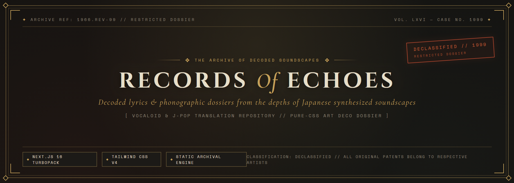
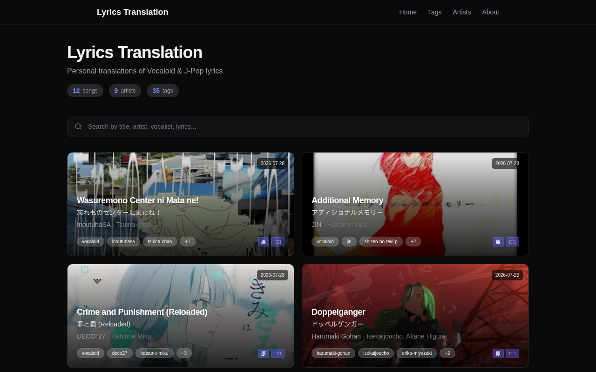
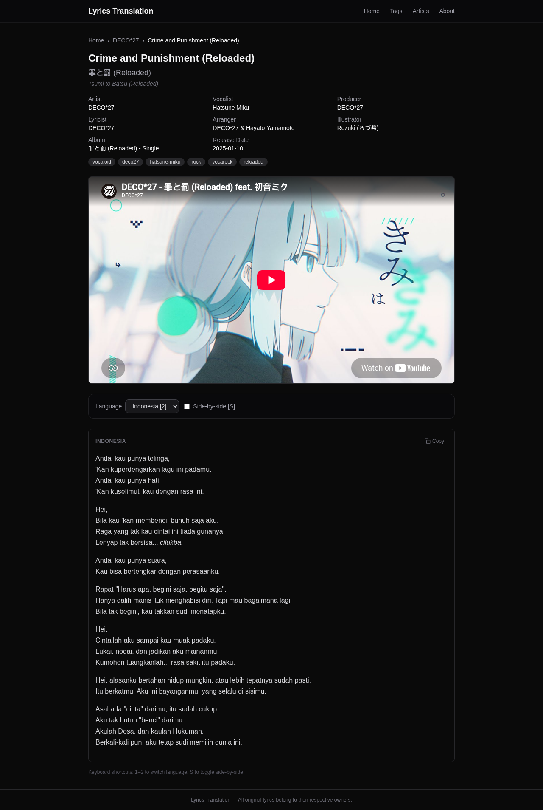

<div align="center">
  
  
  <br />
  <br />

  <h1>Lyrics Translation</h1>
  <p>
    <b>Japanese Song Lyrics Translation Website (Vocaloid & J-Pop)</b><br/>
    Currently focusing on Indonesian translations, but supports multi-language including English, Romaji, and more.
  </p>

  <a href="https://nextjs.org/">
    
  </a>
  <a href="https://tailwindcss.com/">
    
  </a>
  <a href="https://www.typescriptlang.org/">
    
  </a>
  <a href="https://vercel.com/">
    
  </a>
</div>

<br />

Built with Next.js (App Router). Content is stored as Markdown files inside the repository — it can be directly read and shared via GitHub.

---

## Table of Contents
- [Screenshots](#screenshots)
- [Key Features](#key-features)
- [Tech Stack](#tech-stack)
- [Content Structure](#content-structure)
- [Getting Started](#getting-started)
- [Adding New Translations](#adding-new-translations)
- [Application Routes](#application-routes)
- [Disclaimer](#disclaimer)

---

## Screenshots

<div align="center">
  
  <br/>
  <em>Homepage View (Song List & Statistics)</em>
  <br/><br/>
  
  <br/>
  <em>Side-by-Side Mode View for Lyrics Translation</em>
</div>

---

## Key Features

**Flexible Multi-language**
> Dynamic language system; every `.md` file in the song folder is automatically detected as a new language (not limited to hardcoded languages).

**Side-by-side Mode**
> Compare two languages side by side with a wider screen layout.

**Dropdown Language Selector**
> Select languages via a dropdown menu (supports an unlimited number of languages).

**Fuzzy Search**
> Smart search based on title, artist, vocalist, producer, tags, and even lyrics snippets — exact matches are not required.

**YouTube Embed**
> YouTube videos are automatically embedded directly on the song page.

**Markdown Rendering**
> Lyrics are rendered as formatted markdown (bold, italic, etc).

**Furigana Support**
> Supports `{漢字|ふりがな}` syntax to display reading annotations above kanji characters.

**Tags & Stats Counter**
> Filter songs by tags (vocaloid, j-pop, ballad, etc) and view statistics for total songs, artists, and tags on the homepage.

**Keyboard Shortcuts**
> Press `1–9` to switch languages, `S` to toggle side-by-side mode.

---

## Tech Stack

- **Framework**: Next.js 16 (App Router, TypeScript)
- **Styling**: Tailwind CSS v4 + @tailwindcss/typography
- **Content**: Markdown + YAML frontmatter (`gray-matter`)
- **Markdown Rendering**: `react-markdown` + `remark-breaks` + `remark-gfm`
- **Rendering**: Static Site Generation (SSG) via `generateStaticParams`
- **Deploy**: Vercel

---

## Content Structure

Lyrics are stored in the `lyrics/` folder with the following structure:

```text
lyrics/
  Artist_Name/
    Album_Name/              ← optional, only if the song belongs to an album
      Song_Title/
        original.md          ← primary metadata source (highest priority)
        romaji.md            ← optional
        indonesia.md         ← optional
        english.md           ← optional
        [other_language].md  ← optional, automatically detected
    Song_Title_Without_Album/
      original.md
      ...
```

> **Note:** At least one `.md` file must exist in the song folder to be considered valid. Specific languages like `indonesia.md` or `english.md` are not mandatory.

### Metadata Priority

Metadata (title, artist, tags, etc.) is extracted from files with the following priority:

1. `original.md`
2. `romaji.md`
3. `indonesia.md`
4. `english.md`
5. Other `.md` files (alphabetical order)

If the highest-priority file already has metadata, the system will not fetch metadata from other files. If no metadata exists at all, the system will fallback to using the folder names as the title and artist.

<details>
<summary><b>Click to see Markdown File Format</b></summary>
<br/>

```markdown
---
# === Required Fields ===
title: "Song Title"
artist: "Artist Name"
tags: ["vocaloid", "melancholy", "hatsune-miku"]

# === Optional Fields ===
title_original: "曲のタイトル"
title_romaji: "Kyoku no Taitoru"
album: "Album Name"
vocalist: "Hatsune Miku"
producer: "Producer Name"
lyricist: "Lyricist Name"
arranger: "Arranger Name"
illustrator: "MV Illustrator Name"
original_language: "ja"
release_date: "2024-01-01"
translator_note: "Loose translation, not literal"
source_url: "https://youtube.com/..."
translated_date: "2026-07-22"
---

Lyrics content goes here, **supports markdown formatting**.

Newlines are preserved.
*Italic* and **bold** are rendered.

Furigana: {事切|ことき}れて、またね。
```
</details>

<details>
<summary><b>Click to see Furigana (Ruby Text) Explanation</b></summary>
<br/>

Use the `{漢字|ふりがな}` syntax to add furigana above kanji:

```markdown
{事切|ことき}れて、またね。
{宛|あて}もなくただ{辿|たど}る{家路|いえじ}を、
{他人事|ひとごと}のように{日々|ひび}を{眺|なが}めた。
```

The code above will be rendered as text with small annotations above the kanji. Browsers that do not support ruby text will display the reading text inside parentheses as a *fallback*.
</details>

<details>
<summary><b>Click to see Full Metadata Table</b></summary>
<br/>

| Field | Status | Description |
|---|---|---|
| `title` | **Required** | Song title (display/translated version) |
| `artist` | **Required** | Artist/circle name |
| `tags` | **Required** | Array of tags for categorization |
| `title_original` | Optional | Title in the original language (e.g. Japanese) |
| `title_romaji` | Optional | Title in romaji (Latin transliteration) |
| `album` | Optional | Album name |
| `vocalist` | Optional | Vocalist name (e.g. "Hatsune Miku") |
| `producer` | Optional | Producer/composer name |
| `lyricist` | Optional | Lyricist (if different from producer) |
| `arranger` | Optional | Music arranger |
| `illustrator` | Optional | MV/cover illustrator |
| `original_language` | Optional | Original language of the song (default: "ja") |
| `release_date` | Optional | Song release date (YYYY-MM-DD) |
| `translator_note` | Optional | Translator's notes |
| `source_url` | Optional | Source URL (YouTube, NicoNico, etc.) — YouTube is auto-embedded |
| `translated_date` | Optional | Translation date (YYYY-MM-DD) |

</details>

---

## Getting Started

**Prerequisites:** Node.js 18+ and npm

```bash
# Install dependencies
npm install

# Run development server
npm run dev
```

Open [http://localhost:3000](http://localhost:3000) in your browser.

**Build for Production:**
```bash
npm run build
```

---

## Adding New Translations

1. Create a folder in `lyrics/Artist_Name/Song_Title/` (or add `Album_Name` if relevant).
2. Create at least one `.md` file (e.g. `original.md`, `indonesia.md` or `english.md`) with YAML frontmatter format.
3. (Optional) Add other language files — the file name will automatically become the language label on the site.
4. Push to GitHub, and Vercel will automatically trigger a *rebuild*.

### Adding New Languages

Simply create a new `.md` file in the song folder with the desired language name. Our system will dynamically detect it:

```text
lyrics/Artist/Song/
  original.md      → label: "原文"
  romaji.md        → label: "Romaji"
  indonesia.md     → label: "Indonesia"
  english.md       → label: "English"
  korean.md        → label: "Korean"     ← automatically detected!
  spanish.md       → label: "Spanish"    ← automatically detected!
```

---

## Application Routes

| Route | Description |
|---|---|
| `/` | Homepage — list of all songs, search filters, stats |
| `/[artist]` | Artist page — all songs by a specific artist |
| `/[artist]/[song]` | Song detail (without album) |
| `/[artist]/[album]/[song]` | Song detail (with album) |
| `/tags` | List of all tags |
| `/tags/[tag]` | Songs with a specific tag |
| `/artists` | List of all artists |
| `/about` | About this site |

---

## Disclaimer

All original lyrics, music, and artwork belong to their respective artists, producers, and copyright holders. The translations here are personal and non-commercial, created solely for cultural appreciation and educational purposes.
